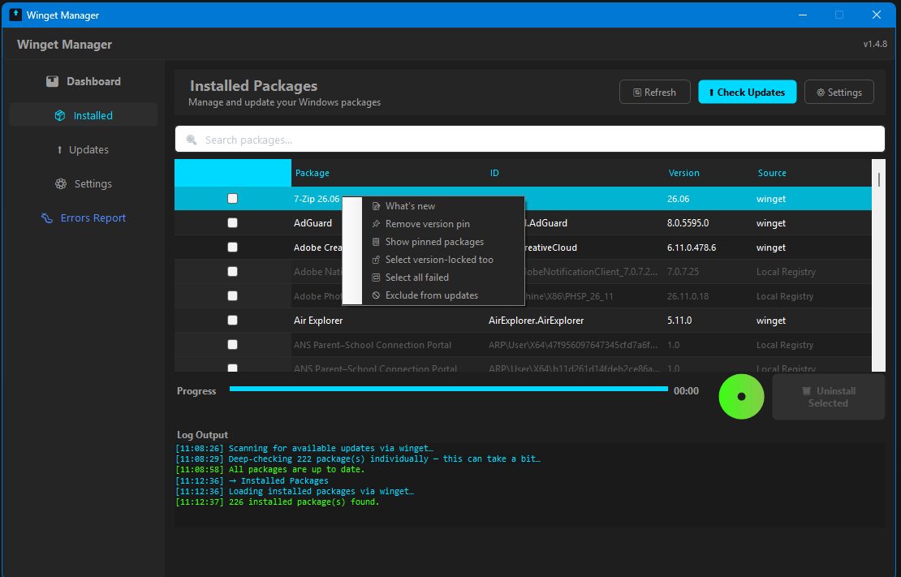
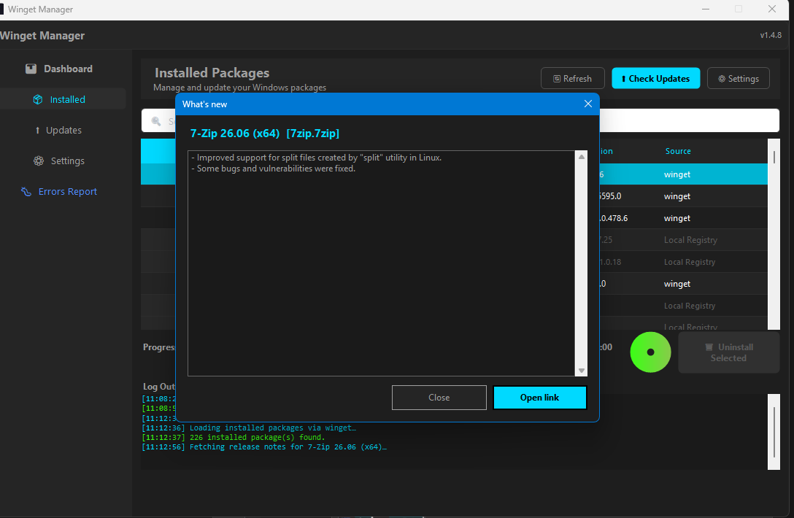
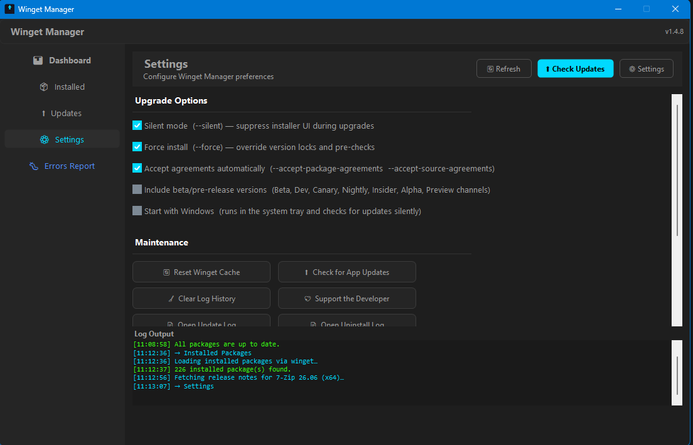
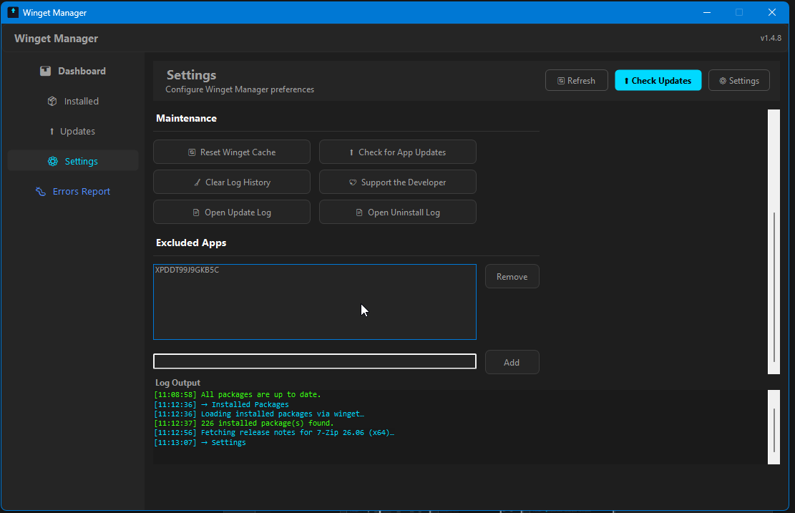

# Winget Manager

A modern, single-file Windows desktop GUI for **Windows Package Manager (winget)** — scan, batch-upgrade, and manage your installed packages without touching a terminal.


**Latest: v1.4.8** — Visual C++ Redistributable AIO is no longer offered again after it has been installed. v1.4.7 added a Cancel button, VC++ AIO installs, automatic handling of Store/MSIX apps that need a restart, and fixes for hangs during large installs (e.g. Visual Studio). See the [CHANGELOG](CHANGELOG.md) for the full history.

---

## Screenshots

**Installed packages** — browse everything winget knows about, with search, sorting and batch uninstall.



**Right-click a package** — read what's new, or exclude it from update scans.


**What's new** — release notes fetched on demand from winget, with a link to the release page.



**Settings** — upgrade options, maintenance tools, and the excluded-apps list.

| | |
|---|---|
|  |  |

---

## Features

| Feature | Description |
|---|---|
| **Available Updates** | Scans winget for all upgradeable packages and displays them in a sortable grid |
| **Batch Upgrade** | Select any subset of packages and upgrade them all with a single click. While it runs, the button turns into **⏹ Cancel**, which stops winget together with the installer it launched |
| **Long installs** | Installers that work silently for a long time (e.g. Visual Studio) log *Still running… N min elapsed* every 2 minutes, so a slow install isn't mistaken for a frozen app |
| **Store / MSIX apps** | Apps that need a restart to finish updating (e.g. Windows Terminal) are retried after their background shell-extension host is stopped. If the update still can't apply, the row shows *↻ Close app to finish* |
| **Visual C++ Redistributable AIO** | Offers [abbodi1406's VC++ AIO](https://github.com/abbodi1406/vcredist) (every runtime from 2005 to the latest) when it isn't installed, and offers newer AIO releases afterwards |
| **Failed Upgrades** | Failed packages stay listed after a rescan. Right-click → *Select all failed* retries them together, and the update log opens automatically when anything fails |
| **Pin Management** | Right-click → *Remove version pin*, *Show pinned packages*, *Select version-locked too* |
| **Start with Windows** | Optional logon start in the system tray (Scheduled Task, falling back to a Run key if that fails). It checks for updates silently and shows a balloon tip when updates are found |
| **Installed Packages** | Browse every package currently installed on the system and uninstall selected ones |
| **Exclude Apps** | Right-click a row → *Exclude from updates* to hide an app from scans; manage the list (add / remove by package Id) under Settings → *Excluded Apps*. Saved in `%AppData%\WingetManager\excluded.txt` |
| **What's New** | Right-click a row → *What's new* to read the package's release notes (fetched on demand from `winget show`), with a link to the release page. Packages whose manifest has no notes say so |
| **Version-locked Packages** | Packages pinned to a version track (e.g. Node LTS) are flagged and skipped by *Select All* |
| **Beta Filter** | Beta / Dev / Canary / Nightly / Insider / Alpha / Preview channels are excluded from scans unless enabled in Settings |
| **Auto-Update** | Checks GitHub for a newer Winget Manager at startup, shows its release notes, and updates in place |
| **Live Log** | Real-time streaming output from winget, persisted to `update.log` and `uninstaller.log` in `%AppData%\WingetManager` |
| **Settings** | Toggle silent mode, force-install, auto-accept agreements, beta versions and *Start with Windows*; manage excluded apps; reset winget sources; open or clear the logs. Choices are saved in `%AppData%\WingetManager\settings.ini` |
| **PATH Repair** | After upgrading winget "portable" packages, user PATH entries that still point at the old version folder are moved to the new one |
| **Single EXE** | All UI libraries (Guna UI2, Guna Charts) are embedded — nothing to install alongside the binary |
| **Always Admin** | App manifest requests administrator elevation at launch so winget operations never fail silently |

---

## Requirements

| Requirement | Notes |
|---|---|
| Windows 10 (1903+) or Windows 11 | .NET 4.8 and winget are pre-installed |
| [Windows Package Manager (winget)](https://aka.ms/winget) | Included with App Installer; update via Microsoft Store if missing |
| .NET Framework 4.8 | Pre-installed on Win10 1903+ and all Win11 builds |
| Administrator privileges | The manifest enforces this automatically at launch |

---

## Installation

No installer needed.

1. Download `WingetManager.exe` from the [Releases](../../releases) page.
2. Double-click — UAC will prompt for elevation.
3. Done.

---

## Building from Source

**Prerequisites:** Visual Studio 2022 (or MSBuild 17+), .NET Framework 4.8 targeting pack.

```powershell
# Clone
git clone https://github.com/ThanhNguyenVN93/Winget-Manager.git
cd Winget-Manager

# Restore NuGet packages (Guna UI2 & Guna Charts)
nuget restore frm_winget_upgrade.slnx

# Release build — output: bin\Release\WingetManager.exe
msbuild frm_winget_upgrade.csproj /p:Configuration=Release
```

The release EXE is self-contained: Guna DLLs are embedded as managed resources and loaded at runtime via `AppDomain.AssemblyResolve`, so no extra files are needed beside the EXE.

---

## Tech Stack

- **C# / .NET Framework 4.8** — WinForms desktop
- **[Guna UI2 v2.0.4.8](https://gunaui.com/)** — modern control theming
- **[Guna Charts v1.1.0](https://gunaui.com/)** — charting controls
- `CancellationToken` cooperative cancellation for background loads
- `AssemblyResolve` + `EmbeddedResource` for single-EXE distribution
- `app.manifest` (`requireAdministrator`) for automatic elevation

---

## Settings Reference

| Setting | winget flag(s) added |
|---|---|
| Silent Mode | `--silent` |
| Force Install | `--force` |
| Accept Agreements | `--accept-package-agreements --accept-source-agreements` |
| Include beta/pre-release versions | _(off by default)_ — includes pre-release channels in the update scan |
| Start with Windows | _(no winget flag)_ — registers a logon task that starts the app with `--tray` |

---

## License

[MIT](LICENSE) © 2026 Thanh Nguyen
